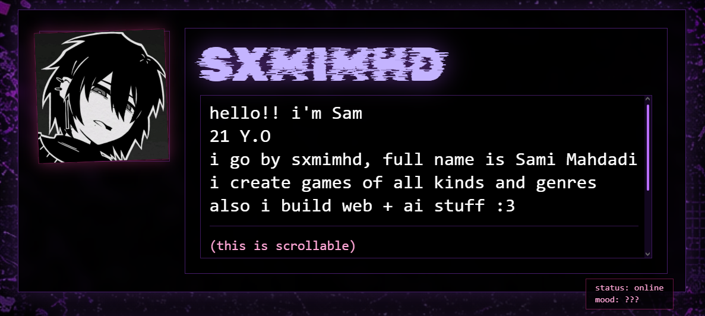
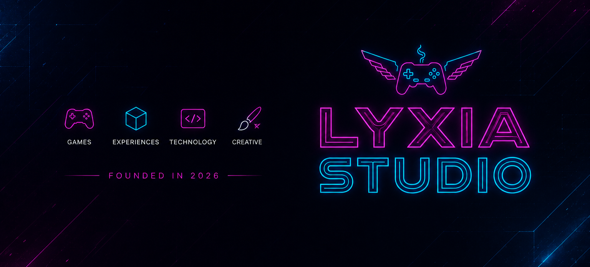

  

<h1 align="center"> Hey, I'm Sam </h1>
<h3 align="center">AI Engineer • Game Developer • Full-Stack Developer</h3>

Building intelligent systems, immersive games, and modern web applications.

<table width="90%">
<tr>
<td colspan="2" valign="top">

<h2 align="center">🤖 AI Engineering</h2>

<table width="100%">
<tr>
<td valign="top" width="33%">

<h4>Machine Learning & Data Science</h4>
<ul>
<li>Data Analysis & Visualization</li>
<li>SQL Analytics</li>
<li>Feature Engineering</li>
<li>Regression & Classification</li>
<li>Clustering & Segmentation</li>
<li>Recommendation Systems</li>
<li>Model Evaluation & Optimization</li>
</ul>

</td>
<td valign="top" width="33%">

<h4>Deep Learning & Computer Vision</h4>
<ul>
<li>Neural Networks</li>
<li>PyTorch Development</li>
<li>Convolutional Neural Networks</li>
<li>Image Classification & Object Detection</li>
<li>Semantic Segmentation</li>
<li>Video Processing & Object Tracking</li>
<li>Transfer Learning</li>
</ul>

</td>
<td valign="top" width="33%">

<h4>Generative AI & LLM Engineering</h4>
<ul>
<li>Large Language Models (LLMs)</li>
<li>Vision Language Models (VLMs)</li>
<li>Retrieval-Augmented Generation (RAG)</li>
<li>Embeddings & Vector Search</li>
<li>Hybrid Retrieval Systems</li>
<li>AI Agents & Tool Calling</li>
<li>Local AI Applications</li>
<li>AI Automation</li>
</ul>

</td>
</tr>
</table>

<h4 align="center">Technologies</h4>

</td>
</tr>

<tr>
<td valign="top" width="50%" bgcolor="#000000">

<h2 align="center">🎮 Game Development</h2>

<h4>Engines</h4>
<ul>
<li>Unity (C#)</li>
<li>Unreal Engine (Blueprints & C++)</li>
</ul>

<h4>Gameplay Programming</h4>
<ul>
<li>Game Architecture & Systems</li>
<li>Dialogue, Inventory & Quest Systems</li>
<li>Save & Load Systems</li>
<li>AI Behaviors & State Machines</li>
<li>Physics Programming</li>
</ul>

<h4>Development</h4>
<ul>
<li>2D & 3D Development</li>
<li>UI Systems</li>
<li>Performance Optimization</li>
<li>WebGL Deployment</li>
<li>Pixel Art Workflows</li>
</ul>

<h4>Technologies</h4>

</td>

<td valign="top" width="50%" bgcolor="#000000">

<h2 align="center">🌐 Full-Stack Development</h2>

<h4>Frontend</h4>
<ul>
<li>React</li>
<li>TypeScript & JavaScript</li>
<li>Vite</li>
<li>Tailwind CSS</li>
<li>Responsive UI / UX</li>
</ul>

<h4>Backend</h4>
<ul>
<li>Python & FastAPI</li>
<li>Node.js & Express.js</li>
<li>Laravel & PHP</li>
<li>REST APIs</li>
<li>Authentication Systems</li>
<li>Payment Integration</li>
</ul>

<h4>Databases & Tools</h4>
<ul>
<li>PostgreSQL, MySQL & SQLite</li>
<li>Qdrant</li>
<li>Git & GitHub</li>
<li>Docker</li>
</ul>

<h4>Technologies</h4>

</td>
</tr>
</table>

# 💼 What I Build

I enjoy building intelligent software that combines Artificial Intelligence, Game Development, and Modern Web Technologies.

My work ranges from data-driven machine learning solutions and autonomous AI agents to immersive games and scalable full-stack applications. I focus on writing clean, maintainable, and production-oriented software while continuously exploring emerging AI technologies.

---
<table align="center" cellspacing="0" cellpadding="0">
<tr>
<td align="center">

<h3>💼 Personal Portfolio</h3>

</td>

<td width="12"></td>

<td align="center">

<h3>🎮 Lyxia Studio</h3>

</td>
</tr>
</table>
